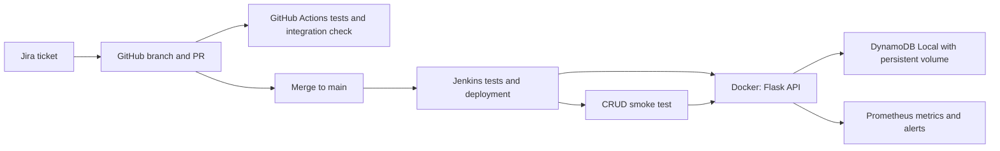

# TaskFlow: a small DevOps demonstration

A Python REST API stores tasks in DynamoDB. The coursework focus is the delivery process: plan in Jira, change code in GitHub, test automatically, deploy through Jenkins, and verify the running service. No frontend is required; PowerShell or Postman demonstrates the API.

## Architecture



## Run on Windows

Prerequisites: Python 3.13, Git, Docker Desktop with Linux containers and Docker Compose v2. Start Docker Desktop before running commands. Docker is currently missing from the machine where this project was prepared.

```powershell
python -m venv .venv
.\.venv\Scripts\python.exe -m pip install -r requirements-dev.txt
.\.venv\Scripts\python.exe -m pytest -q
docker compose up -d --build --wait --wait-timeout 120
.\.venv\Scripts\python.exe scripts/smoke.py
```

Compose creates the DynamoDB `devops-tasks` table automatically with string partition key `id`. The initial table setup retries if the database is still starting. The local credentials are placeholders, not AWS keys. Database data persists in a named Docker volume.

Try the API:

```powershell
Invoke-RestMethod http://localhost:5000/health
$task = Invoke-RestMethod http://localhost:5000/tasks -Method Post -ContentType 'application/json' -Body '{"title":"Demonstrate my DevOps pipeline"}'
Invoke-RestMethod http://localhost:5000/tasks
Invoke-RestMethod "http://localhost:5000/tasks/$($task.id)" -Method Patch -ContentType 'application/json' -Body '{"done":true}'
Invoke-RestMethod "http://localhost:5000/tasks/$($task.id)" -Method Delete
```

Stop with `docker compose down` (retains data). Logs: `docker compose logs --tail=80`. If port 5000 is occupied, stop the other demo before starting this one. `/health` checks database connectivity, not just whether Python is running.

## GitHub setup

Create an empty GitHub repository, then run these commands here, replacing the example URL:

```powershell
git init -b main
git add .
git commit -m "Initial TaskFlow DevOps project"
git remote add origin https://github.com/YOUR-USERNAME/taskflow-devops.git
git push -u origin main
```

The supplied GitHub Actions workflow runs tests and a real DynamoDB Local integration smoke check on pushes and pull requests. Configure a repository rule requiring the `test` check before merging if your repository plan supports that rule. Never commit AWS keys, passwords, or `.env` files.

## Jira setup and traceability

1. Create a Jira project with key `DEVOPS` and a To Do / In Progress / Done board.
2. Create the tasks listed in `docs/jira-backlog.md`. Use the actual issue keys Jira assigns.
3. Install/connect the **GitHub for Atlassian** integration in Jira and grant it access to your selected repository. This may require an account administrator.
4. For a ticket such as `DEVOPS-2`, name a branch `DEVOPS-2-title-validation`, include `DEVOPS-2` in the commit message and pull request title, and check that Jira displays the development link.
5. Move the issue to In Progress before work and Done after successful verification. This project does not automatically transition Jira statuses.

## Jenkins setup

Use a dedicated Linux machine or WSL2 Linux agent with Git, Python 3.13, Python venv support, Docker Engine access and Compose v2. The supplied Jenkinsfile uses Linux shell commands; it does not run directly on a Windows agent. Docker Desktop WSL integration can supply Docker access to a WSL agent. Jenkins setup is a separate prerequisite, not installed by this repository.

1. Install Jenkins LTS using its official installation guide. Install Pipeline, Git and JUnit plugins; the timestamp option also needs Timestamper.
2. Add/configure a trusted Linux agent with label `docker`. Confirm the Jenkins agent account can run `python3`, `git`, and `docker compose version`. Docker access grants powerful host permissions; use a dedicated demo agent.
3. Create a **Pipeline** job, choose **Pipeline script from SCM**, select Git, enter your repository URL, set branch to `*/main`, and script path to `Jenkinsfile`. Store private repository credentials in Jenkins credentials if needed.
4. Click **Build Now** for the first run. Later commits to main are detected by SCM polling about every five minutes. GitHub Actions independently validates PRs.
5. Show Checkout, Test, Deploy local demo, and Smoke test stages, plus the JUnit test report.

The deployed service remains running on the agent at `http://127.0.0.1:5000`. If Jenkins is on another computer, that address refers to that computer; run API commands there. This is local continuous deployment, not public cloud hosting. The API intentionally has no authentication and is bound only to localhost. Do not expose this classroom demo publicly.

To stop the Jenkins deployment on its agent: `docker compose -p taskflow-demo down`. A failed test prevents deployment. A failed post-deployment smoke check marks the build failed but does not automatically roll back. For a recovery demonstration, revert the bad commit in GitHub, rerun Jenkins, and verify the API; the database volume survives the rebuild.

## Optional real AWS DynamoDB

This repository does **not** create cloud resources until you explicitly run the following setup against your AWS account. DynamoDB Local demonstrates the API and data model but is not an AWS cloud deployment. Confirm with your teacher whether a real cloud table is required. AWS usage may incur charges.

Configure AWS CLI credentials locally using an approved profile (prefer SSO). In a new PowerShell session:

```powershell
$env:AWS_PROFILE = 'your-profile'
$env:AWS_DEFAULT_REGION = 'ap-south-1'
$env:TABLE_NAME = 'devops-tasks'
Remove-Item Env:DYNAMODB_ENDPOINT_URL -ErrorAction SilentlyContinue
.\.venv\Scripts\python.exe init_db.py
.\.venv\Scripts\python.exe -m flask --app 'app:create_app()' run --host 127.0.0.1 --port 5000
```

Stop the Docker API first to free port 5000. Also remove any dummy local AWS access-key environment variables if you set them outside Compose, so they do not override your profile. The bootstrap identity needs `dynamodb:CreateTable` and `dynamodb:DescribeTable`; runtime needs `DescribeTable`, `Scan`, `PutItem`, `UpdateItem`, and `DeleteItem`, scoped to your table ARN. Use separate bootstrap/runtime permissions when moving beyond the demo. Confirm the table and items in the AWS console. When finished, delete only the demo table if you no longer need its data.

## What to submit

See `docs/demo-guide.md` for the presentation and evidence checklist. Deliver the repository, README, Jira board screenshots, a linked PR, a successful GitHub Actions run, Jenkins stage/test screenshots, and an API/database demonstration. Only claim integrations you actually connected and ran.

## Monitoring after deployment

Prometheus starts with Compose at http://localhost:9090. Follow `docs/monitoring.md` to show request counts, response times, errors and a service-down alert with recovery. This implements the stated requirement: **code commit → test → build → deployment → monitoring**. Jira supplies planning and traceability before the code commit. Monitoring is ongoing after Jenkins finishes, rather than a one-time test.

## Design limits

This is a deliberately small educational project: no users, authentication, public hosting, automatic rollback or large-scale query design. Listing tasks uses a paginated scan, appropriate only for a small demo. Python dependencies are version pinned but not a complete transitive lock; the DynamoDB Local image uses `latest`, so freeze a tested image digest if exact reproducibility is required.

## Official references

- [AWS DynamoDB Local setup](https://docs.aws.amazon.com/amazondynamodb/latest/developerguide/DynamoDBLocal.DownloadingAndRunning.html)
- [Jenkins installation](https://www.jenkins.io/doc/book/installing/)
- [Jenkins Pipeline](https://www.jenkins.io/doc/book/pipeline/)
- [Jira GitHub issue linking](https://support.atlassian.com/jira-cloud-administration/docs/use-the-github-for-jira-app/)
- [Prometheus getting started](https://prometheus.io/docs/prometheus/latest/getting_started/)
